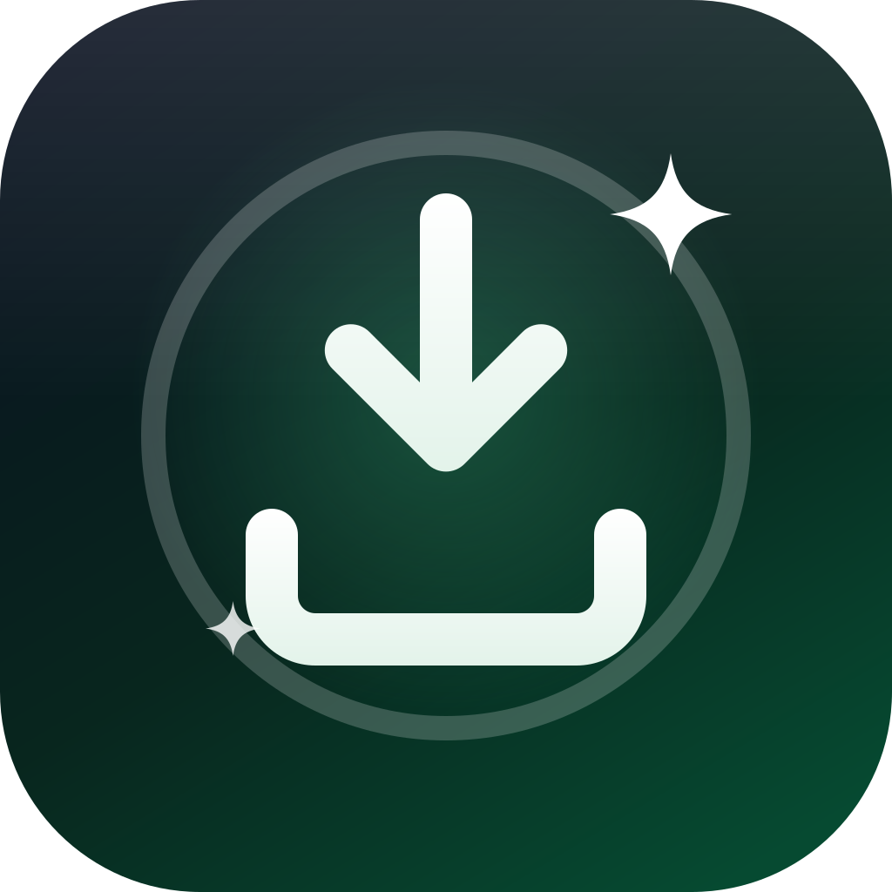

<div align="center">



# AltLoad

**Installez AltStore, SideStore et LiveContainer depuis votre iPhone, signés avec votre propre identifiant Apple. Pas d'ordinateur, pas de certificat partagé.**

[Installer](https://altload.org/) · [Télécharger l'IPA](https://github.com/mirazbakis/AltLoad/releases/latest/download/AltLoad.ipa) · [Ajouter la source](https://altdirect.app/?url=https://raw.githubusercontent.com/mirazbakis/AltLoad/main/source.json) · [Versions](https://github.com/mirazbakis/AltLoad/releases)

[English](README.md) · [简体中文](README.zh-Hans.md) · [Русский](README.ru.md) · Français

</div>

> [!CAUTION]
> **Installez AltLoad uniquement depuis le [site officiel](https://altload.org/) ou [ce dépôt](https://github.com/mirazbakis/AltLoad).**
>
> AltLoad traite le mot de passe de votre identifiant Apple et les données de jumelage de votre iPhone. Une copie modifiée pourrait envoyer les deux à quelqu'un d'autre. Tout autre site, source, hébergeur de fichiers, canal Telegram ou serveur Discord est non officiel, même s'il paraît authentique. C'est aussi le cas de **applejr.net**, qui n'est pas affilié à AltLoad : ses copies ne sont ni publiées ni vérifiées par moi, et elles peuvent être modifiées. AltLoad est gratuit. Je ne publie de versions que sur le site officiel et dans ce dépôt, et les forks n'ont pas le droit d'en publier.
>
> Vous avez déjà utilisé une copie non officielle ? Supprimez-la, changez le mot de passe de votre identifiant Apple sur [account.apple.com](https://account.apple.com), retirez les appareils que vous ne reconnaissez pas et supprimez tous les fichiers de jumelage auxquels elle a pu accéder.

## Ce qu'il fait

L'installation hors App Store (sideloading) passe en général par l'une de ces deux voies. Soit un ordinateur jumelle votre iPhone, signe l'app et la renouvelle tous les 7 jours, soit vous installez à partir d'un certificat partagé payé par son propriétaire, qu'Apple peut révoquer à tout moment, ce qui désactive toutes les apps signées avec lui.

AltLoad fait le travail de l'ordinateur directement sur l'iPhone. Il jumelle le téléphone avec lui-même, signe le store avec votre propre identifiant Apple, l'installe, puis agit comme AltServer sur le même appareil afin qu'AltStore puisse se renouveler. Il fonctionne avec un identifiant Apple gratuit, et votre mot de passe n'est transmis qu'à Apple.

- **Aucun ordinateur** à aucune étape sous iOS 27. Sous iOS 18 à 26, vous créez un fichier de jumelage sur un ordinateur, une seule fois.
- **Votre propre certificat**, donc rien de partagé que quelqu'un d'autre pourrait révoquer.
- **Stores et apps :** AltStore, SideStore, LiveContainer, Husk, UTM, MeloNX et Madeira, ou toute IPA depuis Fichiers.
- **Renouvellements sur le téléphone :** AltStore se renouvelle lui-même une fois Remote AltServer configuré, ou via l'AltServer intégré à AltLoad.
- **Gratuit et open source.** Rien ne quitte le téléphone, à part la connexion à Apple.

| | Avec un ordinateur | Avec un certificat partagé | Avec AltLoad |
| :-- | :-- | :-- | :-- |
| Nécessite un ordinateur | Oui, pour l'installation et chaque renouvellement | Généralement seulement pour la configuration | Non sous iOS 27. Un fichier de jumelage sous iOS 18 à 26 |
| Peut être révoqué sans préavis | Non | Oui, par Apple ou par le propriétaire du certificat | Non. Le certificat vous appartient |
| Renouvellement hebdomadaire | Ordinateur sur le même réseau | Non lié à votre identifiant Apple | Sur l'iPhone |
| JIT | Nécessite un outil sur ordinateur | Ne fait pas partie du certificat | Intégré |
| Coût | L'identifiant Apple gratuit suffit | Fixé par celui qui gère le certificat | Gratuit |

## Compatibilité

| iOS | Installation et signature | Jumelage |
| :-- | :-- | :-- |
| **27 et versions ultérieures** | Pris en charge | Sur l'iPhone, sans ordinateur |
| **18 à 26** | Pris en charge | Importer un fichier de jumelage distant créé une fois sur un ordinateur avec [iloader](https://github.com/nab138/iloader) ou [idevice_pair](https://github.com/jkcoxson/idevice_pair) |
| **17 et antérieures** | Non pris en charge | Non pris en charge |

Vous avez aussi besoin du [Mode développeur](https://developer.apple.com/documentation/xcode/enabling-developer-mode-on-a-device), de [LocalDevVPN](https://apps.apple.com/app/id6755608044) depuis l'App Store et d'un identifiant Apple. Avec un identifiant Apple gratuit, les apps durent 7 jours.

## Installation

**1. Obtenir AltLoad.** Choisissez une méthode :

- **Installation avec identifiant Apple (altpair).** Signé avec votre propre identifiant Apple, sans ordinateur et sans profil DNS. Vous installez trois apps gratuites de l'App Store et suivez les étapes sur le [site officiel](https://altload.org/). Voir [altpair/README.md](altpair/README.md).
- **Installation directe.** La méthode la plus rapide, avec un certificat partagé. Ouvrez le [site officiel](https://altload.org/) dans Safari, acceptez les Conditions, ajoutez le profil DNS et touchez une installation signée.
- **AltStore ou SideStore.** Si vous en utilisez déjà un, [ajoutez la source](https://altdirect.app/?url=https://raw.githubusercontent.com/mirazbakis/AltLoad/main/source.json) et recevez les mises à jour depuis là.
- **Votre propre outil de signature.** Téléchargez `AltLoad.ipa` depuis les [Versions](https://github.com/mirazbakis/AltLoad/releases).

**2. Jumeler votre iPhone.** Dans AltLoad, ouvrez **Outils › Jumeler**, puis allez dans **Réglages › Confidentialité et sécurité › Mode développeur › Jumeler avec AltLoad** et saisissez le code.

**3. Installer un store.** Activez LocalDevVPN, choisissez un store dans l'onglet **Installer** et connectez-vous.

## Fonctionnalités

| | |
| :-- | :-- |
| **Jumelage sur l'appareil** | Sous iOS 27, jumelez en saisissant un code depuis la Dynamic Island |
| **AltServer sur l'appareil** | AltStore trouve AltLoad comme il trouve un ordinateur, et il peut rester actif en arrière-plan |
| **Stores** | AltStore Classic et Beta, SideStore et SideStore + LiveContainer, stable ou nightly |
| **Vos propres apps** | Signez et installez n'importe quelle IPA depuis Fichiers |
| **Équipe de développement** | Choisissez l'équipe qui signe, si votre identifiant Apple appartient à plusieurs équipes |
| **Droits** | Capacités par app, préréglages pour les émulateurs et les outils réseau, et ce que le dernier profil a réellement accordé |
| **JIT** | Ouvrez les apps avec JIT depuis Outils, Raccourcis, Siri ou l'écran d'accueil. Épinglez celles que vous utilisez, exécutez des scripts et acceptez des demandes depuis des liens |
| **AltStore sans AltServer** | AltLoad place le fichier de jumelage de cet iPhone là où AltStore 2.3.1 et versions ultérieures le cherchent, afin qu'AltStore puisse se renouveler seul |
| **Plusieurs identifiants Apple** | Enregistrez-en plusieurs et changez lors de la connexion. Chaque app mémorise l'identifiant Apple qui l'a signée |
| **Fichiers de jumelage** | Placez le fichier de jumelage de cet iPhone dans SideStore, StikDebug et d'autres apps installées hors App Store |
| **Renouvellement automatique** | Renouvelle les apps avant leur expiration et re-signe en arrière-plan celles qui ont été révoquées, avec LocalDevVPN activé et le mot de passe enregistré |
| **Journaux** | Voyez ce qu'AltLoad a fait et copiez un rapport en cas d'échec. Les adresses e-mail sont masquées et les mots de passe ne sont jamais journalisés |
| **Outils supplémentaires** | Simulation de position, certificats, App IDs et options d'extensions d'app |
| **Langues** | Anglais, chinois, français, allemand, italien, japonais, portugais (Brésil), russe et espagnol |

## Dépannage

Quand une opération échoue, ouvrez **Outils › Assistance › Journaux** et touchez **Copier**, ou touchez **Copier le journal** sur l'écran d'erreur. Collez-le dans un [ticket](https://github.com/mirazbakis/AltLoad/issues).

<details>
<summary><b>« Impossible de se connecter à cet iPhone » ou « Connexion refusée »</b></summary>
<br>

LocalDevVPN doit être connecté, le Mode développeur activé et cet iPhone jumelé dans **Outils › Jumeler**. Autorisez l'accès au réseau local si AltLoad le demande. Désactivez toute autre app VPN ou proxy. Si l'échec persiste, désactivez puis réactivez LocalDevVPN, ou jumelez à nouveau.
</details>

<details>
<summary><b>La connexion échoue</b></summary>
<br>

Laissez **Réglages › Anisette** sur **Automatique**. Si la connexion échoue toujours, touchez **Réinitialiser les données Anisette** et réessayez quelques minutes plus tard. Si AltLoad indique que les connexions sont suspendues, attendez le délai affiché.
</details>

<details>
<summary><b>« Pas assez d'App IDs disponibles »</b></summary>
<br>

Un identifiant Apple gratuit peut créer 10 App IDs par semaine, et chaque extension d'app en nécessite normalement un. Avant d'installer, réglez **Extensions d'app** sur **Conserver, utiliser le profil principal** ou **Supprimer les extensions**.
</details>

<details>
<summary><b>« Limite de certificats atteinte »</b></summary>
<br>

Les identifiants Apple gratuits n'obtiennent que quelques certificats de développement. AltLoad vous demande lequel révoquer. Les apps signées avec celui-ci ailleurs cessent de s'ouvrir jusqu'à ce qu'elles soient à nouveau signées.
</details>

<details>
<summary><b>Un store ne se télécharge pas</b></summary>
<br>

Si toutes les sources d'un store sont indisponibles, obtenez son IPA autrement et utilisez **Installer une IPA depuis Fichiers** dans le menu **…** de l'onglet Installer.
</details>

## Compilation

Il vous faut Xcode, Rust avec les cibles `aarch64-apple-ios` et `aarch64-apple-ios-sim`, et XcodeGen.

```sh
make test   # Tests Rust pour le cœur et altpair
make ipa    # build/AltLoad.ipa, signé ad hoc comme les versions publiées
make sim    # un build pour le Simulator
```

| Chemin | Contenu |
| :-- | :-- |
| `ios/` | L'app SwiftUI, l'extension Live Activity et les traductions |
| `core/` | Le cœur Rust pour le jumelage, le tunnel vers l'appareil, la connexion, la signature et l'installation |
| `altpair/` | Les outils propres à AltLoad qui l'installent avec votre identifiant Apple, sans ordinateur. Voir son [README](altpair/README.md) |
| `site/` | La page d'installation sur GitHub Pages |
| `signing/` | Scripts et packs de certificats pour les installations signées |
| `docs/` | [Fonctionnement](docs/HOW-IT-WORKS.md) et notes de version |

## Licence

AltLoad est open source sous une licence personnalisée basée sur MIT. Vous pouvez lire son code, le modifier, le compiler pour vous-même et réutiliser des parties dans des projets non commerciaux, avec la mention *"Based on AltLoad by mirazbakis"*. Les versions ne peuvent être distribuées que via ce dépôt et le site officiel. Voir [LICENSE.md](LICENSE.md).

Signalez les problèmes de sécurité comme décrit dans [SECURITY.md](SECURITY.md). Utiliser AltLoad implique d'accepter les [Conditions d'utilisation](https://altload.org/terms.html). AltLoad n'est affilié ni à Apple ni à aucune app qu'il installe.

Voir [ACKNOWLEDGMENTS.md](ACKNOWLEDGMENTS.md) pour les projets dont AltLoad dépend, et [THIRD_PARTY_NOTICES.md](THIRD_PARTY_NOTICES.md) pour les licences.
