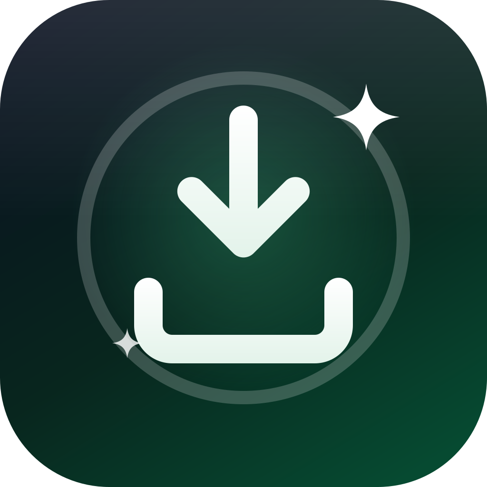

<div align="center">



# AltLoad

**iPhone에서 자신의 Apple ID로 서명한 AltStore, SideStore, LiveContainer를 설치합니다. 컴퓨터도, 공유 인증서도 필요하지 않습니다.**

[](https://github.com/mirazbakis/AltLoad/releases/latest)
[](https://github.com/mirazbakis/AltLoad/releases)
[](#요구-사항)
[](https://github.com/mirazbakis/AltLoad/stargazers)

[설치](https://altload.org/) · [IPA 다운로드](https://github.com/mirazbakis/AltLoad/releases/latest/download/AltLoad.ipa) · [소스 추가](https://altdirect.app/?url=https://raw.githubusercontent.com/mirazbakis/AltLoad/main/source.json) · [릴리스](https://github.com/mirazbakis/AltLoad/releases)

[English](README.md) · [简体中文](README.zh-Hans.md) · [Русский](README.ru.md) · [Français](README.fr.md) · 한국어

</div>

> [!CAUTION]
> **altload.org**와 이 저장소만 공식 출처입니다. AltLoad는 무료이며 Apple ID 암호와 페어링 데이터를 다루므로, 다른 곳에서 받은 사본은 이를 탈취하도록 변조되었을 수 있습니다. 이미 사용했다면 삭제하고 [account.apple.com](https://account.apple.com)에서 Apple ID 암호를 변경하십시오.

## 기능 소개

사이드로딩에는 보통 앱에 서명하고 7일마다 새로 고치는 컴퓨터가 필요하거나, Apple이 언제든 폐기할 수 있는 공유 인증서가 필요합니다. AltLoad는 컴퓨터의 역할을 iPhone에서 수행합니다. iPhone을 자기 자신과 페어링하고, 자신의 Apple ID로 스토어에 서명하여 설치한 뒤, 같은 기기에서 AltServer 역할을 하여 AltStore가 새로 고칠 수 있게 합니다. 무료 Apple ID로도 동작하며, 암호는 Apple에만 전송됩니다.

| | 컴퓨터 사용 | 공유 인증서 사용 | AltLoad 사용 |
| :-- | :-- | :-- | :-- |
| 컴퓨터 필요 여부 | 설치와 매번의 새로 고침에 필요 | 보통 설정할 때만 필요 | iOS 27에서는 불필요. iOS 18~26에서는 페어링 파일 1개 필요 |
| 예고 없이 폐기될 수 있는지 | 아니요 | 예. Apple 또는 인증서 소유자가 폐기 가능 | 아니요. 인증서는 사용자 본인의 것입니다 |
| 주간 새로 고침 | 같은 네트워크의 컴퓨터 | Apple ID와 무관 | iPhone에서 수행 |
| JIT | 컴퓨터 쪽 도구 필요 | 인증서에 포함되지 않음 | 내장 |
| 비용 | 무료 Apple ID로 가능 | 인증서 운영자가 정함 | 무료 |

## 요구 사항

| iOS | 설치 및 서명 | 페어링 |
| :-- | :-- | :-- |
| **27 이상** | 지원 | iPhone에서 컴퓨터 없이 수행 |
| **18~26** | 지원 | 컴퓨터에서 [iloader](https://github.com/nab138/iloader) 또는 [idevice_pair](https://github.com/jkcoxson/idevice_pair)로 한 번 만든 원격 페어링 파일을 가져오기 |
| **17 이하** | 미지원 | 미지원 |

추가로 필요한 것:

- [개발자 모드](https://developer.apple.com/documentation/xcode/enabling-developer-mode-on-a-device) 켜기
- App Store의 [LocalDevVPN](https://apps.apple.com/app/id6755608044)
- Apple ID. 무료 Apple ID를 사용하면 앱이 7일간 유지됩니다

## 설치

**1. AltLoad 받기.** 방법 중 하나를 선택하십시오.

| 방법 | 적합한 경우 | 방법 설명 |
| :-- | :-- | :-- |
| **Apple ID 설치** (권장) | 컴퓨터와 DNS 프로파일 없이 자신의 Apple ID로 서명하려는 경우 | App Store의 무료 앱 3개를 설치하고 [altload.org](https://altload.org/)의 단계를 따르십시오. [altpair/README.md](altpair/README.md)를 참고하십시오 |
| **직접 설치** | 가장 빠른 방법. 공유 인증서를 사용하므로 폐기될 수 있습니다 | Safari에서 [altload.org](https://altload.org/)를 열고 약관에 동의한 뒤 DNS 프로파일을 추가하고 서명된 설치를 탭하십시오 |
| **AltStore 또는 SideStore** | 이미 사용 중인 경우 | [소스를 추가](https://altdirect.app/?url=https://raw.githubusercontent.com/mirazbakis/AltLoad/main/source.json)하고 거기서 업데이트를 받으십시오 |
| **직접 서명** | IPA에 직접 서명하는 경우 | [릴리스](https://github.com/mirazbakis/AltLoad/releases)에서 `AltLoad.ipa`를 다운로드하십시오 |

**2. iPhone 페어링.** AltLoad에서 **도구 › 페어링**을 열고, **설정 › 개인정보 보호 및 보안 › 개발자 모드 › AltLoad와 페어링**으로 이동하여 코드를 입력하십시오.

**3. 스토어 설치.** LocalDevVPN을 켜고, **설치** 탭에서 스토어를 선택한 뒤 로그인하십시오.

**4. 앱 추가 설치(선택 사항).** 설치 탭의 **…** 메뉴에서 **소스**를 열어 AltStore 형식의 소스를 추가하고 그 앱을 설치하거나, 가지고 있는 IPA는 **파일에서 IPA 설치…**로 설치하십시오. [Sources](docs/SOURCES.md)(영어)를 참고하십시오.

## 기능

**설치 및 서명**
- **스토어:** AltStore Classic 및 Beta, SideStore 및 SideStore + LiveContainer(안정 버전 또는 나이틀리). 그리고 Husk, UTM, MeloNX, Madeira
- **자체 앱:** 파일 앱의 IPA에 서명하고 설치
- **소스:** AltStore 및 SideStore 소스를 추가하고, 앱을 둘러보고, 릴리스 노트를 읽고, 이전 버전을 설치하며, 업데이트가 나왔는지 확인
- **개발자 팀:** Apple ID가 여러 팀에 속한 경우 서명할 팀 선택
- **여러 Apple ID:** 둘 이상 저장하고 로그인할 때 전환. 각 앱은 자신을 서명한 Apple ID를 기억함
- **권한(Entitlements):** 앱별 기능, 에뮬레이터 및 네트워크 도구용 프리셋, 마지막 프로파일이 실제로 부여한 항목 확인
- **인증서 이름:** 설정에서 AltLoad가 요청하는 개발용 인증서의 이름 지정

**페어링 및 새로 고침**
- **기기 내 페어링:** iOS 27에서는 Dynamic Island에 표시된 코드를 입력하여 페어링
- **기기 내 AltServer:** AltStore가 컴퓨터를 찾는 방식 그대로 AltLoad를 찾으며, 백그라운드에서 계속 실행 가능
- **AltServer 없는 AltStore:** AltLoad가 이 iPhone의 페어링 파일을 AltStore 2.3.1 이상이 찾는 위치에 두므로, AltStore가 스스로 새로 고칠 수 있음
- **자동 새로 고침:** LocalDevVPN이 켜져 있고 암호가 저장된 경우, 만료 전에 앱을 새로 고치고 폐기된 앱은 백그라운드에서 다시 서명
- **페어링 파일:** 이 iPhone의 페어링 파일을 SideStore, StikDebug 및 기타 사이드로드된 앱에 넣기

**JIT 및 도구**
- **JIT:** 도구, 단축어, Siri 또는 홈 화면에서 JIT로 앱 열기. 자주 쓰는 앱을 고정하고, 스크립트를 실행하며, 링크로 요청을 받음
- **추가 도구:** 위치 시뮬레이션, 인증서, App ID, 앱 확장 옵션
- **로그:** 설정에서 AltLoad의 동작을 확인하고, 문제가 생기면 보고서를 복사. 이메일은 가려지며 암호는 절대 기록되지 않음

**언어:** 영어, 한국어, 중국어, 프랑스어, 독일어, 이탈리아어, 일본어, 포르투갈어(브라질), 러시아어, 스페인어

## 문제 해결

문제가 생기면 **설정 › 로그**를 열고 **복사**를 탭하거나, 오류 화면에서 **로그 복사**를 탭하십시오. 이를 [이슈](https://github.com/mirazbakis/AltLoad/issues)에 붙여넣으십시오. 가장 흔한 문제는 아래와 같으며, 전체 목록은 [Troubleshooting](docs/TROUBLESHOOTING.md)(영어)에 있습니다.

<details>
<summary><b>"이 iPhone에 연결할 수 없음" 또는 "Connection refused"</b></summary>
<br>

LocalDevVPN이 연결되어 있고, 개발자 모드가 켜져 있으며, 이 iPhone이 **도구 › 페어링**에서 페어링되어 있어야 합니다. AltLoad가 요청하면 로컬 네트워크 접근을 허용하십시오. 다른 VPN이나 프록시 앱은 끄십시오. 그래도 실패하면 LocalDevVPN을 껐다 켜거나 다시 페어링하십시오.
</details>

<details>
<summary><b>"Couldn't open a tunnel to this device"</b></summary>
<br>

페어링 서비스는 응답했지만 다음 연결이 멈췄습니다. LocalDevVPN을 껐다 켜고, 몇 초 기다린 뒤 다시 시도하십시오. AltLoad 1.8.0 이상은 한 번에 하나의 연결만 설정하므로, 설치와 JIT 탭이 서로를 멈추게 하지 않습니다.
</details>

<details>
<summary><b>로그인 실패</b></summary>
<br>

**설정 › Anisette**를 **자동**으로 두십시오. 그래도 로그인이 실패하면 **Anisette 데이터 재설정**을 탭하고 몇 분 뒤 다시 시도하십시오. AltLoad에 로그인이 일시 중지되었다고 표시되면 표시된 시간만큼 기다리십시오.
</details>

<details>
<summary><b>"사용 가능한 App ID가 부족함"</b></summary>
<br>

무료 Apple ID는 일주일에 App ID를 10개까지 만들 수 있으며, 앱 확장마다 보통 하나가 필요합니다. 설치 전에 **앱 확장**을 **유지, 기본 프로파일 사용** 또는 **확장 제거**로 설정하십시오.
</details>

<details>
<summary><b>"인증서 한도에 도달함"</b></summary>
<br>

무료 Apple ID는 개발용 인증서를 몇 개만 받을 수 있습니다. AltLoad가 폐기할 인증서를 묻습니다. 그 인증서로 다른 곳에서 서명한 앱은 다시 서명되기 전까지 열리지 않습니다.
</details>

<details>
<summary><b>스토어가 다운로드되지 않음</b></summary>
<br>

스토어의 소스가 모두 다운된 경우, 다른 방법으로 해당 IPA를 구한 뒤 설치 탭의 **…** 메뉴에서 **파일에서 IPA 설치…**를 사용하십시오.
</details>

## 문서

가이드는 영어로 작성되어 있습니다.

| 가이드 | 내용 |
| :-- | :-- |
| [FAQ](docs/FAQ.md) | 암호, 한도, 폐기, AltLoad가 AltStore 및 SideStore와 다른 점 |
| [Sources](docs/SOURCES.md) | 소스 추가, 업데이트, AltLoad가 읽는 소스 필드 |
| [Troubleshooting](docs/TROUBLESHOOTING.md) | 오류와 해결 방법 |
| [How it works](docs/HOW-IT-WORKS.md) | 페어링, 터널, 서명 및 설치를 단계별로 설명 |
| [altpair](altpair/README.md) | 컴퓨터 없이 자신의 Apple ID로 AltLoad 설치 |
| [Contributing](CONTRIBUTING.md) | 빌드, 프로젝트 구조, pull request |

## 빌드

Xcode, `aarch64-apple-ios` 및 `aarch64-apple-ios-sim` 타깃이 포함된 Rust, XcodeGen이 필요합니다.

```sh
make test   # 코어와 altpair용 Rust 테스트
make ipa    # build/AltLoad.ipa, 릴리스 빌드와 같이 ad-hoc 서명됨
make sim    # 시뮬레이터 빌드
```

pull request를 열기 전에 [Contributing](CONTRIBUTING.md)을 읽어 주십시오.

| 경로 | 내용 |
| :-- | :-- |
| `ios/` | SwiftUI 앱, 실시간 현황 확장 및 번역 |
| `core/` | 페어링, 기기 터널, 로그인, 서명 및 설치를 담당하는 Rust 코어 |
| `altpair/` | 컴퓨터 없이 Apple ID로 AltLoad를 설치하는 AltLoad 자체 도구. [README](altpair/README.md)를 참고하십시오 |
| `site/` | GitHub Pages의 설치 페이지 |
| `signing/` | 서명된 설치용 스크립트 및 인증서 팩 |
| `docs/` | 가이드, [How it works](docs/HOW-IT-WORKS.md) 및 릴리스 노트 |

## 라이선스

AltLoad는 MIT 기반의 자체 라이선스로 공개된 오픈 소스입니다. 코드를 읽고, 수정하고, 직접 빌드하고, *"Based on AltLoad by mirazbakis"* 표기와 함께 비상업적 프로젝트에서 일부를 재사용할 수 있습니다. 빌드는 이 저장소와 공식 웹사이트를 통해서만 배포할 수 있습니다. [LICENSE.md](LICENSE.md)를 참고하십시오.

보안 문제는 [SECURITY.md](SECURITY.md)에 설명된 방법으로 신고하십시오. AltLoad를 사용하면 [서비스 약관](https://altload.org/terms.html)에 동의하는 것입니다. AltLoad는 Apple 및 AltLoad가 설치하는 어떤 앱과도 관련이 없습니다.

AltLoad가 사용하는 프로젝트는 [ACKNOWLEDGMENTS.md](ACKNOWLEDGMENTS.md)를, 라이선스는 [THIRD_PARTY_NOTICES.md](THIRD_PARTY_NOTICES.md)를 참고하십시오.
