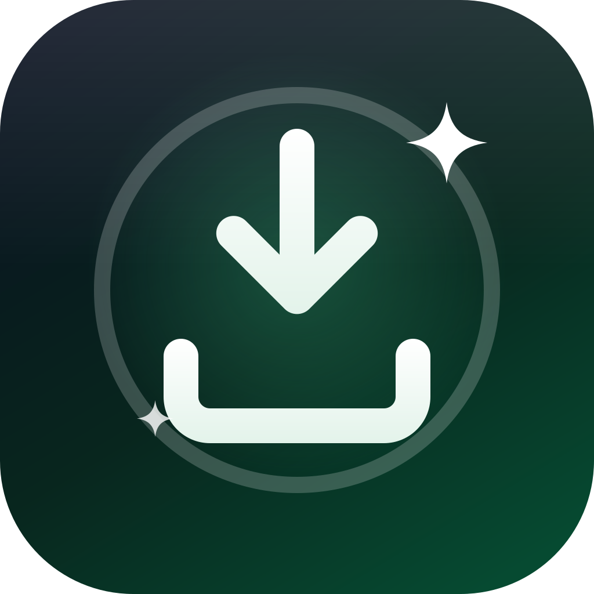

<div align="center">



# AltLoad

**Install AltStore, SideStore and LiveContainer from your iPhone, signed with your own Apple ID. No computer, no shared certificate.**

[Install](https://altload.org/) · [Download the IPA](https://github.com/mirazbakis/AltLoad/releases/latest/download/AltLoad.ipa) · [Add the source](https://altdirect.app/?url=https://raw.githubusercontent.com/mirazbakis/AltLoad/main/source.json) · [Releases](https://github.com/mirazbakis/AltLoad/releases)

English · [简体中文](README.zh-Hans.md) · [Русский](README.ru.md) · [Français](README.fr.md)

</div>

> [!CAUTION]
> **altload.org** and this repository are the only official sources. AltLoad is free and handles your Apple ID password and pairing data, so a copy from anywhere else could be modified to steal them. Already used one? Delete it and change your Apple ID password at [account.apple.com](https://account.apple.com).

## What it does

Sideloading usually needs either a computer that signs your apps and refreshes them every 7 days, or a shared certificate that Apple can revoke at any time. AltLoad does the computer's job on the iPhone: it pairs the phone with itself, signs the store with your own Apple ID, installs it, and then acts as AltServer on the same device so AltStore can refresh. It works with a free Apple ID, and your password goes to Apple only.

| | With a computer | With a shared certificate | With AltLoad |
| :-- | :-- | :-- | :-- |
| Needs a computer | Yes, for install and every refresh | Usually only to set up | No on iOS 27. One pairing file on iOS 18 to 26 |
| Can be revoked without notice | No | Yes, by Apple or the certificate's owner | No. The certificate is yours |
| Weekly refresh | Computer on the same network | Not tied to your Apple ID | On the iPhone |
| JIT | Needs a computer-side tool | Not part of the certificate | Built in |
| Cost | Free Apple ID works | Set by whoever runs the certificate | Free |

## Requirements

| iOS | Installing and signing | Pairing |
| :-- | :-- | :-- |
| **27 and later** | Supported | On the iPhone, with no computer |
| **18 to 26** | Supported | Import a remote pairing file made once on a computer with [iloader](https://github.com/nab138/iloader) or [idevice_pair](https://github.com/jkcoxson/idevice_pair) |
| **17 and earlier** | Not supported | Not supported |

You also need:

- [Developer Mode](https://developer.apple.com/documentation/xcode/enabling-developer-mode-on-a-device) turned on
- [LocalDevVPN](https://apps.apple.com/app/id6755608044) from the App Store
- An Apple ID. With a free one, apps last 7 days

## Install

**1. Get AltLoad.** Pick one route:

| Route | Best for | How |
| :-- | :-- | :-- |
| **Apple ID Install** (recommended) | Signing with your own Apple ID, no computer and no DNS profile | Install three free App Store apps and follow the steps on [altload.org](https://altload.org/). See [altpair/README.md](altpair/README.md) |
| **Direct Install** | The fastest route. Uses a shared certificate, so it can be revoked | Open [altload.org](https://altload.org/) in Safari, accept the Terms, add the DNS profile and tap a signed install |
| **AltStore or SideStore** | You already run one | [Add the source](https://altdirect.app/?url=https://raw.githubusercontent.com/mirazbakis/AltLoad/main/source.json) and get updates there |
| **Your own signer** | You sign IPAs yourself | Download `AltLoad.ipa` from [Releases](https://github.com/mirazbakis/AltLoad/releases) |

**2. Pair your iPhone.** In AltLoad, open **Tools › Pair**, then go to **Settings › Privacy & Security › Developer Mode › Pair with AltLoad** and enter the code.

**3. Install a store.** Turn on LocalDevVPN, choose a store on the **Install** tab and sign in.

## Features

**Installing and signing**
- **Stores:** AltStore Classic and Beta, SideStore and SideStore + LiveContainer, stable or nightly. Also Husk, UTM, MeloNX and Madeira
- **Your own apps:** sign and install any IPA from Files
- **Developer team:** pick which team signs, if your Apple ID belongs to more than one
- **Several Apple IDs:** save more than one and switch when you sign in. Each app remembers the Apple ID that signed it
- **Entitlements:** per-app capabilities, presets for emulators and network tools, and what the last profile actually granted

**Pairing and refresh**
- **On-device pairing:** on iOS 27, pair by entering a code from your Dynamic Island
- **On-device AltServer:** AltStore finds AltLoad the way it finds a computer, and it can stay running in the background
- **AltStore without AltServer:** AltLoad leaves this iPhone's pairing file where AltStore 2.3.1 and later look for it, so AltStore can refresh by itself
- **Automatic refresh:** refreshes apps before they expire and re-signs revoked ones in the background, with LocalDevVPN on and the password saved
- **Pairing files:** place this iPhone's pairing file in SideStore, StikDebug and other sideloaded apps

**JIT and tools**
- **JIT:** open apps with JIT from Tools, Shortcuts, Siri or the Home Screen. Pin the ones you use, run scripts, and take requests from links
- **More tools:** location simulation, certificates, App IDs, and app extension options
- **Logs:** see what AltLoad did, and copy a report when something fails. Emails are masked and passwords are never logged

**Languages:** English, Chinese, French, German, Italian, Japanese, Portuguese (Brazil), Russian and Spanish.

## Troubleshooting

When something fails, open **Settings › Logs** and tap **Copy**, or tap **Copy Log** on the error screen. Paste it into an [issue](https://github.com/mirazbakis/AltLoad/issues).

<details>
<summary><b>"Can't connect to this iPhone" or "Connection refused"</b></summary>
<br>

LocalDevVPN must be connected, Developer Mode on, and this iPhone paired in **Tools › Pair**. Allow Local Network access if AltLoad asks. Turn off any other VPN or proxy app. If it still fails, turn LocalDevVPN off and on, or pair again.
</details>

<details>
<summary><b>Sign-in fails</b></summary>
<br>

Leave **Settings › Anisette** on **Automatic**. If sign-in still fails, tap **Reset Anisette Data** and try again a few minutes later. If AltLoad says sign-ins are paused, wait for the time it shows.
</details>

<details>
<summary><b>"Not enough available App IDs"</b></summary>
<br>

A free Apple ID can create 10 App IDs a week, and each app extension normally needs one. Before installing, set **App Extensions** to **Keep, Use Main Profile** or **Remove Extensions**.
</details>

<details>
<summary><b>"Certificate limit reached"</b></summary>
<br>

Free Apple IDs get only a few development certificates. AltLoad asks which one to revoke. Apps signed with it elsewhere stop opening until they're signed again.
</details>

<details>
<summary><b>A store won't download</b></summary>
<br>

If a store's sources are all down, get its IPA another way and use **Install IPA from Files** in the Install tab's **…** menu.
</details>

## Building

You need Xcode, Rust with the `aarch64-apple-ios` and `aarch64-apple-ios-sim` targets, and XcodeGen.

```sh
make test   # Rust tests for the core and altpair
make ipa    # build/AltLoad.ipa, ad-hoc signed like the release builds
make sim    # a Simulator build
```

| Path | Contents |
| :-- | :-- |
| `ios/` | The SwiftUI app, Live Activity extension and translations |
| `core/` | The Rust core for pairing, the device tunnel, sign-in, signing and installing |
| `altpair/` | AltLoad's own tools that install it with your Apple ID, no computer. See its [README](altpair/README.md) |
| `site/` | The install page on GitHub Pages |
| `signing/` | Scripts and certificate packs for the signed installs |
| `docs/` | [How it works](docs/HOW-IT-WORKS.md) and release notes |

## License

AltLoad is open source under a custom MIT-based license. You can read it, change it, build it for yourself and reuse parts in non-commercial projects with the credit *"Based on AltLoad by mirazbakis"*. Builds may only be distributed through this repository and the official website. See [LICENSE.md](LICENSE.md).

Report security issues as described in [SECURITY.md](SECURITY.md). Using AltLoad means agreeing to the [Terms of Service](https://altload.org/terms.html). AltLoad isn't affiliated with Apple or with any app it installs.

See [ACKNOWLEDGMENTS.md](ACKNOWLEDGMENTS.md) for the projects AltLoad relies on, and [THIRD_PARTY_NOTICES.md](THIRD_PARTY_NOTICES.md) for licenses.
