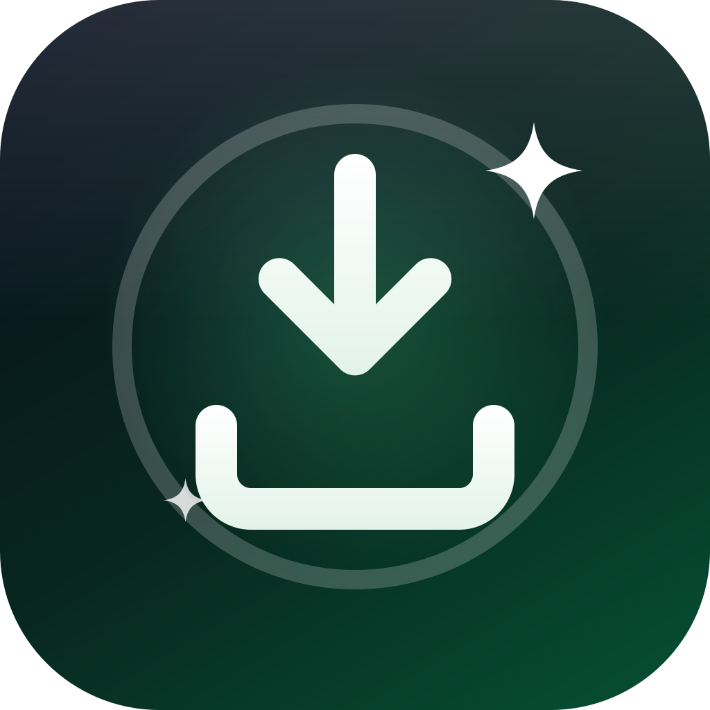

<div align="center">



# AltLoad

**Sideload AltStore, SideStore and LiveContainer from the iPhone itself.**<br>
No computer, no subscription, your own Apple ID.

<h3>
<a href="https://mirazbakis.github.io/AltLoad/altstore.html"><picture><source media="(prefers-color-scheme: dark)" srcset="docs/assets/altstore-badge-dark.png"></picture></a>
&nbsp;
<a href="https://altdirect.app/?url=https://raw.githubusercontent.com/mirazbakis/AltLoad/main/source.json"></a>
&nbsp;
<a href="https://github.com/mirazbakis/AltLoad/releases/latest/download/AltLoad.ipa"></a>
</h3>

[](https://mirazbakis.github.io/AltLoad/)
[](https://github.com/mirazbakis/AltLoad/releases)
[](#install)
[](docs/HOW-IT-WORKS.md)
[](LICENSE.md)

</div>

---

Normally a store like AltStore needs a computer: to pair with the iPhone, sign the app and install it, then to keep refreshing it every week. AltLoad is that computer, running on the phone. It pairs the iPhone with itself, signs the store with your Apple ID, installs it, and then keeps an AltServer running so AltStore refreshes on its own.

## Install

### Get AltLoad

Pick whichever fits:

- **Signed install.** Open **[mirazbakis.github.io/AltLoad](https://mirazbakis.github.io/AltLoad/)** in Safari, accept the Terms, add the DNS profile and tap any signed install.
- **AltStore or SideStore.** Add the source `https://raw.githubusercontent.com/mirazbakis/AltLoad/main/source.json` (or tap **Add to AltStore** / **Add to SideStore** on the website). You get updates there too.
- **Your own signer.** Download `AltLoad.ipa` from [Releases](https://github.com/mirazbakis/AltLoad/releases) and sign it with a tool you already have.

### Set it up

1. Turn on **Developer Mode** and get **[LocalDevVPN](https://apps.apple.com/app/id6755608044)** from the App Store.
2. In AltLoad, go to **Tools › Pair**. The code shows up in your Dynamic Island. Open **Settings › Developer › Pair with AltLoad** and type it in. On iOS 18 to 26, import a pairing file instead (see the table below).
3. Switch LocalDevVPN on, pick a store on the **Install** tab and sign in.

AltLoad reminds you the day before anything expires. A free Apple ID works; apps last 7 days.

| iOS | |
| :-- | :-- |
| **27 and later** | Everything, including pairing on the device |
| **18 to 26** | Make a pairing file once on a computer with [iloader](https://github.com/nab138/iloader) or [idevice_pair](https://github.com/jkcoxson/idevice_pair), then **Tools › Pair › Import Pairing File** |
| **17 and earlier** | Not supported |

## What it does

- **Stores.** AltStore Classic and Beta, SideStore, SideStore + LiveContainer, stable or nightly, or any IPA from Files.
- **App extensions, your choice.** Keep them, keep them on the main app's profile (one App ID), or remove them. That matters with a free Apple ID's 10 App IDs a week.
- **AltServer on the phone.** AltStore finds it like it would find a computer, and it keeps running in the background.
- **Sign-in that keeps working.** AltLoad health-checks anisette servers (Windows ADI first, then jkcoxson's Mac ADI and the rest) and moves on when Apple refuses one.
- **When sources go down.** Mirrors, GitHub releases, a known-good build and AltLoad's own saved copy, in that order.
- **Tools.** Pairing files for sideloaded apps like SideStore and StikDebug, entitlements, JIT, location simulation and certificate management.

## Privacy

AltLoad has no servers, no accounts and no analytics. Your Apple ID password goes to Apple and nowhere else. If you choose *Remember password*, it stays in this iPhone's Keychain and never syncs. Anisette servers never see it.

That only holds for official builds. Get AltLoad from the [website](https://mirazbakis.github.io/AltLoad/) or [Releases](https://github.com/mirazbakis/AltLoad/releases), nowhere else. Report security issues privately as described in [SECURITY.md](SECURITY.md).

## Troubleshooting

<details>
<summary><b>Sign-in fails</b></summary>

Apple has been refusing many public anisette servers since October 2026. Leave **Settings › Anisette** on **Automatic**. If it still fails, tap **Reset Anisette Data** and try again a few minutes later. **Settings › Apple ID › Sign In** tests your account without installing anything.
</details>

<details>
<summary><b>"Not enough available App IDs"</b></summary>

A free Apple ID can create 10 App IDs a week, and each app extension normally needs one. Before installing, set **App Extensions** to **Keep, Use Main Profile** or **Remove Extensions**.
</details>

<details>
<summary><b>"Can't connect to this iPhone"</b></summary>

LocalDevVPN must be connected, Developer Mode on, and this iPhone paired in **Tools › Pair**. If all three are true, pair again.
</details>

<details>
<summary><b>"Certificate limit reached"</b></summary>

Free Apple IDs get only a few development certificates. AltLoad asks which one to revoke. Apps signed with it elsewhere stop opening until they're signed again.
</details>

<details>
<summary><b>SideStore won't download</b></summary>

If SideStore's source, mirror, GitHub and the known-good build are all down, get a SideStore IPA another way and use **Install IPA from Files** in the Install tab's **…** menu.
</details>

## How it's built

A SwiftUI app on top of a Rust core. Rust pairs, opens the tunnel through LocalDevVPN, signs in to Apple, signs and installs. Swift draws the screens, runs the on-device AltServer and the pairing-code Live Activity. [docs/HOW-IT-WORKS.md](docs/HOW-IT-WORKS.md) walks through every step.

```
ios/
  App/          SwiftUI app: Core/ (logic), Features/ (screens), UI/, Resources/
  Widgets/      Live Activity extension (Dynamic Island, Lock Screen)
  Shared/       code compiled into both targets
core/           Rust core, exposed to Swift through core/include/altload.h
site/           the install page on GitHub Pages
signing/        cert packs and scripts for the signed installs on the site
scripts/        build-rust.sh → AltLoadFFI.xcframework
docs/           how it works, release notes, logo
.github/        Build IPA, Sign IPAs & Deploy OTA, Sign IPA
```

AltLoad is under a custom MIT license: free to use, change and share for non-commercial purposes, as long as you credit *"Based on AltLoad by mirazbakis"* with a link, give your version its own name and icon, and never send anyone's Apple ID details anywhere but Apple. See [LICENSE.md](LICENSE.md).

## Credits

Built on [idevice](https://github.com/jkcoxson/idevice), [LocalDevVPN](https://github.com/jkcoxson/LocalDevVPN) and the anisette servers of **Jackson Coxson**, [isideload](https://github.com/nab138/isideload) by **nab138** and [StikPair](https://github.com/StephenDev0/StikPair) by **StephenDev0**. Installs [AltStore](https://altstore.io) by **Riley Testut**, [SideStore](https://github.com/SideStore) and [LiveContainer](https://github.com/LiveContainer/LiveContainer), always downloaded from their own sources. Full notices are in [THIRD_PARTY_NOTICES.md](THIRD_PARTY_NOTICES.md).

---

<sub>© 2026 mirazbakis. Licensed under the [AltLoad License (MIT, Non-Commercial, Attribution)](LICENSE.md). Using AltLoad means agreeing to the [Terms of Service](https://mirazbakis.github.io/AltLoad/terms.html). Not affiliated with Apple, AltStore, Riley Testut, SideStore or LiveContainer.</sub>
