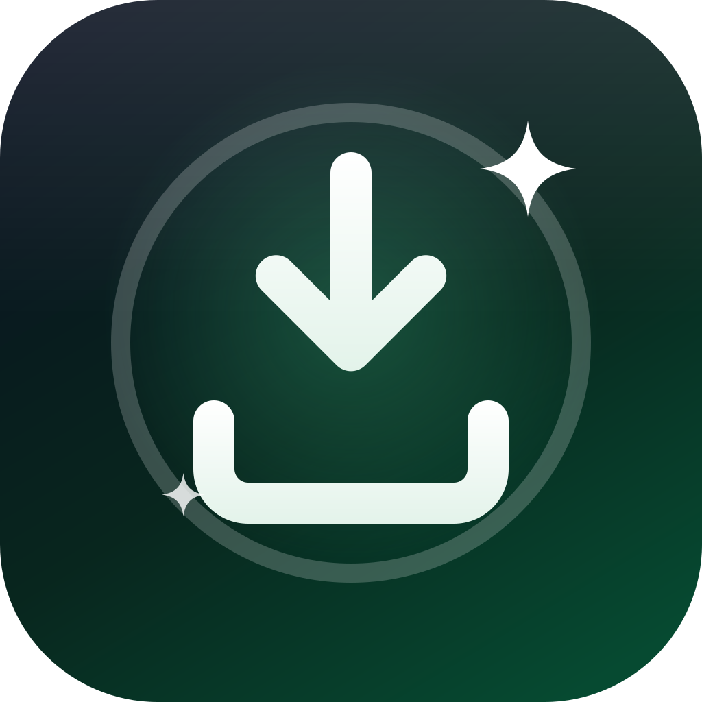

# AltLoad

**Install AltStore, SideStore and LiveContainer from your iPhone, signed with your own Apple ID. No computer, no shared certificate.**

&nbsp;

> [!CAUTION]
> **Only install AltLoad from the [official website](https://mirazbakis.github.io/AltLoad/) or [this repository](https://github.com/mirazbakis/AltLoad).**
>
> AltLoad handles your Apple ID password and your iPhone's pairing data, and a modified copy could send both to someone else. Any other website, source, file host, Telegram channel or Discord server is unofficial, however real it looks. AltLoad is free. The only builds I publish are on the official website and in this repository, and forks may not publish builds.
>
> Already used an unofficial copy? Delete it, change your Apple ID password at [account.apple.com](https://account.apple.com), remove any devices you don't recognize, and delete any pairing files it could reach.

## At a glance

- No computer at any step on iOS 27. On iOS 18 to 26 you make one pairing file on a computer, once.
- Signed with your own Apple ID, so no shared certificate exists that someone can revoke.
- Installs AltStore, SideStore, LiveContainer, Husk, UTM, MeloNX and Madeira, or any IPA from Files.
- Sets AltStore up to refresh itself: AltLoad hands it this iPhone's pairing file for Remote AltServer, and runs AltServer on the phone until then.
- JIT for emulators is built in. I haven't tested it on a device yet.
- Free and open source. Nothing leaves the phone except the sign-in to Apple.

## Why AltLoad

Sideloading usually means one of two things. Either a computer pairs with your iPhone, signs the app and refreshes it every 7 days, or you install from a shared certificate that its owner pays for and Apple can revoke at any time, taking every app signed with it.

I built AltLoad to do the computer's job on the iPhone. It pairs the phone with itself, signs the store with your own Apple ID, installs it, and then acts as AltServer on the same device so AltStore can refresh. It works with a free Apple ID, and your password goes to Apple only.

| | With a computer | With a shared certificate | With AltLoad |
| :-- | :-- | :-- | :-- |
| Needs a computer | Yes, for install and every refresh | Usually only to set up | No on iOS 27. One pairing file from a computer on iOS 18 to 26 |
| Can be revoked without notice | No | Yes, by Apple or the certificate's owner | No. The certificate is yours |
| Your Apple ID stays on your device | Yes | Not needed, because the certificate isn't yours | Yes |
| Weekly refresh | Computer on the same network | Not tied to your Apple ID's 7-day limit | On the iPhone: AltStore does it itself once Remote AltServer is set up, or through AltLoad's built-in AltServer |
| JIT | Needs a computer-side tool | Not part of the certificate | Built in. I haven't tested the new request handling on a device yet |
| Cost | Free Apple ID works | Set by whoever runs the certificate | Free and open source |

## Compatibility

| iOS | Installing and signing | Pairing |
| :-- | :-- | :-- |
| **27 and later** | Supported | On the iPhone, with no computer |
| **18 to 26** | Supported | Import a remote pairing file made once on a computer with [iloader](https://github.com/nab138/iloader) or [idevice_pair](https://github.com/jkcoxson/idevice_pair) |
| **17 and earlier** | Not supported | Not supported |

You also need [Developer Mode](https://developer.apple.com/documentation/xcode/enabling-developer-mode-on-a-device), [LocalDevVPN](https://apps.apple.com/app/id6755608044) from the App Store and an Apple ID. With a free Apple ID, apps last 7 days.

## Features

| | |
| :-- | :-- |
| **On-device pairing** | On iOS 27, pair by entering a code from your Dynamic Island |
| **On-device AltServer** | AltStore finds AltLoad the way it finds a computer, and it can stay running in the background |
| **Stores** | AltStore Classic and Beta, SideStore and SideStore + LiveContainer, stable or nightly |
| **Your own apps** | Sign and install any IPA from Files. Husk, UTM, MeloNX and Madeira are also in the store list |
| **JIT for emulators** | **Open with JIT** from Tools or right after installing. AltLoad stays with the app while it asks for JIT memory, runs scripts (its own, the app's, or ones you import), and takes requests from links and Shortcuts. Not tested on a device yet |
| **AltStore without AltServer** | AltLoad leaves this iPhone's pairing file where AltStore 2.3.1 and later look for it. Set up Remote AltServer in AltStore once and it refreshes apps by itself |
| **Several Apple IDs** | Save more than one and switch when you sign in. Each app remembers the Apple ID that signed it |
| **Pairing files** | Place this iPhone's pairing file in SideStore, StikDebug and other sideloaded apps |
| **Developer tools** | JIT, location simulation, entitlements, certificates and App IDs |
| **App extensions** | Keep them, share the main app's profile to use one App ID, or remove them |
| **Fast installs** | The IPA unpacks while you sign in, and the success screen shows how long the install took |
| **Careful sign-in** | Pauses after repeated failures, forgets a password Apple rejects, and checks which anisette servers respond |
| **Stays current** | Reminders before a signature expires, update notices, and fallbacks when a store's source is down |
| **Languages** | English, French, German, Italian, Chinese and Russian |

## Install

**1. Get AltLoad.** I offer four routes. Pick one:

- **AltPair (Apple ID Install).** Pick this if you want AltLoad signed with your own Apple ID and have no computer. You install three free App Store apps and follow the steps on the [official website](https://mirazbakis.github.io/AltLoad/). No DNS profile, no shared certificate. See [AltPair/README.md](AltPair/README.md).
- **Direct Install with the DNS profile.** Pick this if you want the fastest route and accept a shared certificate. Open the [official website](https://mirazbakis.github.io/AltLoad/) in Safari, accept the Terms, add the DNS profile and tap a signed install.
- **Add the source to AltStore or SideStore.** Pick this if you already run one of them and want updates there. [Add the source with AltDirect](https://altdirect.app/?url=https://raw.githubusercontent.com/mirazbakis/AltLoad/main/source.json).
- **Download the IPA.** Pick this if you have your own signer. Get `AltLoad.ipa` from [Releases](https://github.com/mirazbakis/AltLoad/releases).

**2. Pair your iPhone.** In AltLoad, open **Tools › Pair**, then go to **Settings › Privacy & Security › Developer Mode › Pair with AltLoad** and enter the code.

**3. Install a store.** Turn on LocalDevVPN, choose a store on the **Install** tab and sign in.

## Troubleshooting

<b>Sign-in fails</b>

 

Leave **Settings › Anisette** on **Automatic**. If sign-in still fails, tap **Reset Anisette Data** and try again a few minutes later. If AltLoad says sign-ins are paused, wait for the time it shows.

<b>"Not enough available App IDs"</b>

 

A free Apple ID can create 10 App IDs a week, and each app extension normally needs one. Before installing, set **App Extensions** to **Keep, Use Main Profile** or **Remove Extensions**.

<b>"Can't connect to this iPhone"</b>

 

LocalDevVPN must be connected, Developer Mode on, and this iPhone paired in **Tools › Pair**. If all three are true, pair again.

<b>"Certificate limit reached"</b>

 

Free Apple IDs get only a few development certificates. AltLoad asks which one to revoke. Apps signed with it elsewhere stop opening until they're signed again.

<b>A store won't download</b>

 

If a store's sources are all down, get its IPA another way and use **Install IPA from Files** in the Install tab's **…** menu.

## How it's built

| Path | Contents |
| :-- | :-- |
| `ios/` | The SwiftUI app, Live Activity extension and translations |
| `core/` | The Rust core for pairing, the device tunnel, sign-in, signing and installing |
| `AltPair/` | AltPair: AltLoad's own tools that install it with your Apple ID, no computer. See its [README](AltPair/README.md) |
| `site/` | The install page on GitHub Pages, and the web steps for the Apple ID Install route |
| `signing/` | Scripts and certificate packs for the signed installs |
| `scripts/` | Build scripts |
| `docs/` | [How it works](docs/HOW-IT-WORKS.md) and release notes |

## License

AltLoad is open source under a custom MIT-based license. You can read it, change it, build it for yourself and reuse parts in non-commercial projects with the credit *"Based on AltLoad by mirazbakis"*. Builds may only be distributed through this repository and the official website. See [LICENSE.md](LICENSE.md).

Report security issues as described in [SECURITY.md](SECURITY.md). Using AltLoad means agreeing to the [Terms of Service](https://mirazbakis.github.io/AltLoad/terms.html). AltLoad isn't affiliated with Apple or with any app it installs.

See [ACKNOWLEDGMENTS.md](ACKNOWLEDGMENTS.md) for the projects AltLoad relies on, and [THIRD_PARTY_NOTICES.md](THIRD_PARTY_NOTICES.md) for licenses.
