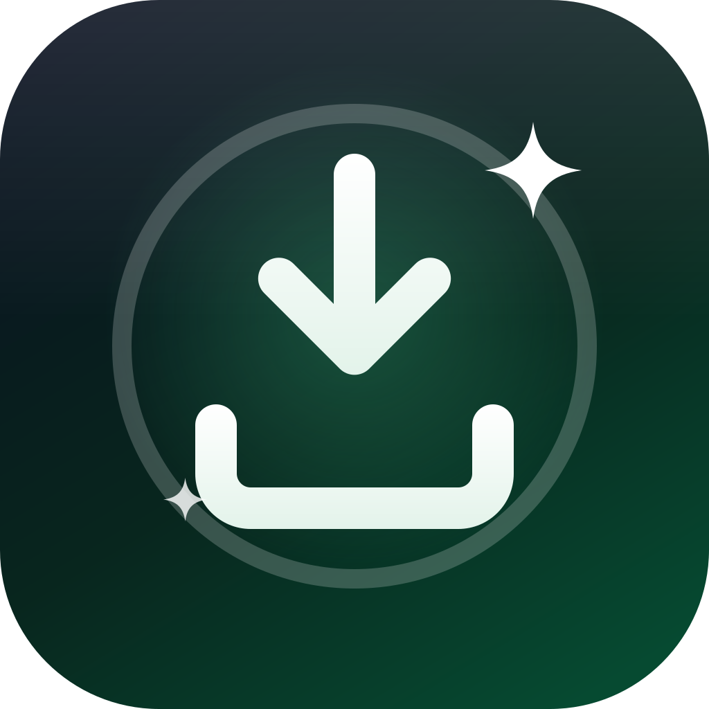

<div align="center">



# AltLoad

**Установите AltStore, SideStore и LiveContainer с iPhone, подписав их своим Apple ID. Без компьютера и без общего сертификата.**

[Установить](https://altload.org/) · [Скачать IPA](https://github.com/mirazbakis/AltLoad/releases/latest/download/AltLoad.ipa) · [Добавить источник](https://altdirect.app/?url=https://raw.githubusercontent.com/mirazbakis/AltLoad/main/source.json) · [Релизы](https://github.com/mirazbakis/AltLoad/releases)

[English](README.md) · [简体中文](README.zh-Hans.md) · Русский · [Français](README.fr.md)

</div>

> [!CAUTION]
> **[altload.org](https://altload.org/) и этот репозиторий — единственные официальные источники.** AltLoad бесплатен и работает с паролем вашего Apple ID и данными сопряжения, поэтому копия из другого места может быть изменена, чтобы их украсть. Уже использовали такую? Удалите её и смените пароль Apple ID на [account.apple.com](https://account.apple.com).

## Что он делает

Установка приложений в обход App Store обычно требует либо компьютера, который подписывает приложения и обновляет их каждые 7 дней, либо общего сертификата, который Apple может отозвать в любой момент. AltLoad делает работу компьютера на iPhone: он сопрягает телефон с самим собой, подписывает магазин вашим Apple ID, устанавливает его, а затем работает как AltServer на том же устройстве, чтобы AltStore мог обновляться. Работает с бесплатным Apple ID, а ваш пароль передается только Apple.

| | С компьютером | С общим сертификатом | С AltLoad |
| :-- | :-- | :-- | :-- |
| Нужен компьютер | Да, для установки и каждого обновления | Обычно только для настройки | Нет в iOS 27. Один файл сопряжения в iOS 18–26 |
| Может быть отозван без предупреждения | Нет | Да, Apple или владельцем сертификата | Нет. Сертификат ваш |
| Еженедельное обновление | Компьютер в той же сети | Не привязано к вашему Apple ID | На iPhone |
| JIT | Нужен инструмент на компьютере | Не входит в сертификат | Встроен |
| Стоимость | Работает с бесплатным Apple ID | Определяет тот, кто владеет сертификатом | Бесплатно |

## Требования

| iOS | Установка и подпись | Сопряжение |
| :-- | :-- | :-- |
| **27 и новее** | Поддерживается | На iPhone, без компьютера |
| **18–26** | Поддерживается | Импорт удаленного файла сопряжения, созданного один раз на компьютере с помощью [iloader](https://github.com/nab138/iloader) или [idevice_pair](https://github.com/jkcoxson/idevice_pair) |
| **17 и ниже** | Не поддерживается | Не поддерживается |

Также понадобятся:

- [Режим разработчика](https://developer.apple.com/documentation/xcode/enabling-developer-mode-on-a-device) включен
- [LocalDevVPN](https://apps.apple.com/app/id6755608044) из App Store
- Apple ID. С бесплатным приложения работают 7 дней

## Установка

**1. Получите AltLoad.** Выберите один из путей:

| Путь | Подходит для | Как |
| :-- | :-- | :-- |
| **Установка через Apple ID** (рекомендуется) | Подпись вашим Apple ID, без компьютера и без профиля DNS | Установите три бесплатных приложения из App Store и следуйте шагам на [altload.org](https://altload.org/). См. [altpair/README.md](altpair/README.md) |
| **Прямая установка** | Самый быстрый путь. Использует общий сертификат, поэтому может быть отозван | Откройте [altload.org](https://altload.org/) в Safari, примите условия, добавьте профиль DNS и нажмите подписанную установку |
| **AltStore или SideStore** | Вы уже используете один из них | [Добавьте источник](https://altdirect.app/?url=https://raw.githubusercontent.com/mirazbakis/AltLoad/main/source.json) и получайте обновления там |
| **Собственный подписывающий инструмент** | Вы подписываете IPA сами | Скачайте `AltLoad.ipa` из [Релизов](https://github.com/mirazbakis/AltLoad/releases) |

**2. Сопрягите iPhone.** В AltLoad откройте **Инструменты › Создание пары**, затем перейдите в **Настройки › Конфиденциальность и безопасность › Режим разработчика › Создание пары с AltLoad** и введите код.

**3. Установите магазин.** Включите LocalDevVPN, выберите магазин на вкладке **Установка** и войдите в аккаунт.

## Возможности

**Установка и подпись**
- **Магазины:** AltStore Classic и Beta, SideStore и SideStore + LiveContainer, стабильные или ночные сборки. Также Husk, UTM, MeloNX и Madeira
- **Ваши приложения:** подпишите и установите любой IPA из Файлов
- **Команда разработчика:** выберите, какая команда подписывает, если ваш Apple ID входит в несколько
- **Несколько Apple ID:** сохраняйте несколько и переключайтесь при входе. Каждое приложение помнит Apple ID, которым оно подписано
- **Права:** возможности для каждого приложения, пресеты для эмуляторов и сетевых инструментов, а также то, что реально выдал последний профиль

**Сопряжение и обновление**
- **Сопряжение на устройстве:** на iOS 27 сопряжение выполняется вводом кода из Dynamic Island
- **AltServer на устройстве:** AltStore находит AltLoad так же, как находит компьютер, и может работать в фоне
- **AltStore без AltServer:** AltLoad размещает файл сопряжения этого iPhone там, где его ищут AltStore 2.3.1 и новее, поэтому AltStore может обновляться сам
- **Автоматическое обновление:** обновляет приложения до истечения срока и переподписывает отозванные в фоновом режиме, при включенном LocalDevVPN и сохраненном пароле
- **Файлы сопряжения:** размещайте файл сопряжения этого iPhone в SideStore, StikDebug и других приложениях, установленных в обход App Store

**JIT и инструменты**
- **JIT:** открывайте приложения с JIT из Инструментов, Команд, Siri или с экрана Домой. Закрепляйте нужные, запускайте скрипты и принимайте запросы по ссылкам
- **Дополнительные инструменты:** имитация местоположения, сертификаты, App ID и параметры расширений приложений
- **Журнал:** смотрите, что делал AltLoad, и копируйте отчет при сбое. Адреса почты скрываются, пароли никогда не записываются в журнал

**Языки:** английский, китайский, французский, немецкий, итальянский, японский, португальский (Бразилия), русский и испанский.

## Устранение неполадок

Если что-то не работает, откройте **Настройки › Журнал** и нажмите **Скопировать** или нажмите **Скопировать журнал** на экране ошибки. Вставьте его в [задачу](https://github.com/mirazbakis/AltLoad/issues).

<details>
<summary><b>«Не удаётся подключиться к этому iPhone» или «Connection refused»</b></summary>
<br>

LocalDevVPN должен быть подключен, Режим разработчика включен, а этот iPhone сопряжен в **Инструменты › Создание пары**. Разрешите доступ к локальной сети, если AltLoad запросит. Выключите другие VPN или прокси-приложения. Если не помогло, выключите и снова включите LocalDevVPN или выполните сопряжение заново.
</details>

<details>
<summary><b>Вход не работает</b></summary>
<br>

Оставьте **Настройки › Anisette** в режиме **Автоматически**. Если вход всё равно не работает, нажмите **Сбросить данные Anisette** и попробуйте через несколько минут. Если AltLoad сообщает, что входы приостановлены, подождите указанное им время.
</details>

<details>
<summary><b>«Недостаточно доступных App ID»</b></summary>
<br>

Бесплатный Apple ID может создать 10 App ID в неделю, а каждому расширению приложения обычно нужен один. Перед установкой выставьте **Расширения приложений** в **Оставить, использовать основной профиль** или **Удалить расширения**.
</details>

<details>
<summary><b>«Достигнут лимит сертификатов»</b></summary>
<br>

Бесплатные Apple ID получают лишь несколько сертификатов разработчика. AltLoad спросит, какой отозвать. Приложения, подписанные им в другом месте, перестанут открываться, пока их не подпишут заново.
</details>

<details>
<summary><b>Магазин не загружается</b></summary>
<br>

Если все источники магазина недоступны, получите его IPA другим способом и используйте **Установить IPA из Файлов** в меню **…** на вкладке «Установка».
</details>

## Сборка

Понадобятся Xcode, Rust с целями `aarch64-apple-ios` и `aarch64-apple-ios-sim`, а также XcodeGen.

```sh
make test   # Тесты Rust для ядра и altpair
make ipa    # build/AltLoad.ipa, подпись ad-hoc, как у релизных сборок
make sim    # сборка для Simulator
```

| Путь | Содержимое |
| :-- | :-- |
| `ios/` | Приложение на SwiftUI, расширение Live Activity и переводы |
| `core/` | Ядро на Rust для сопряжения, туннеля к устройству, входа, подписи и установки |
| `altpair/` | Собственные инструменты AltLoad для установки с вашим Apple ID без компьютера. См. его [README](altpair/README.md) |
| `site/` | Страница установки на GitHub Pages |
| `signing/` | Скрипты и наборы сертификатов для подписанных установок |
| `docs/` | [Как это работает](docs/HOW-IT-WORKS.md) и примечания к релизам |

## Лицензия

AltLoad распространяется с открытым исходным кодом по собственной лицензии на основе MIT. Вы можете читать его, изменять, собирать для себя и повторно использовать части в некоммерческих проектах с указанием авторства *"Based on AltLoad by mirazbakis"*. Сборки можно распространять только через этот репозиторий и официальный сайт. См. [LICENSE.md](LICENSE.md).

Сообщайте о проблемах безопасности так, как описано в [SECURITY.md](SECURITY.md). Используя AltLoad, вы соглашаетесь с [Условиями использования](https://altload.org/terms.html). AltLoad не связан с Apple и с любым приложением, которое он устанавливает.

Проекты, на которые опирается AltLoad, перечислены в [ACKNOWLEDGMENTS.md](ACKNOWLEDGMENTS.md), а лицензии — в [THIRD_PARTY_NOTICES.md](THIRD_PARTY_NOTICES.md).
