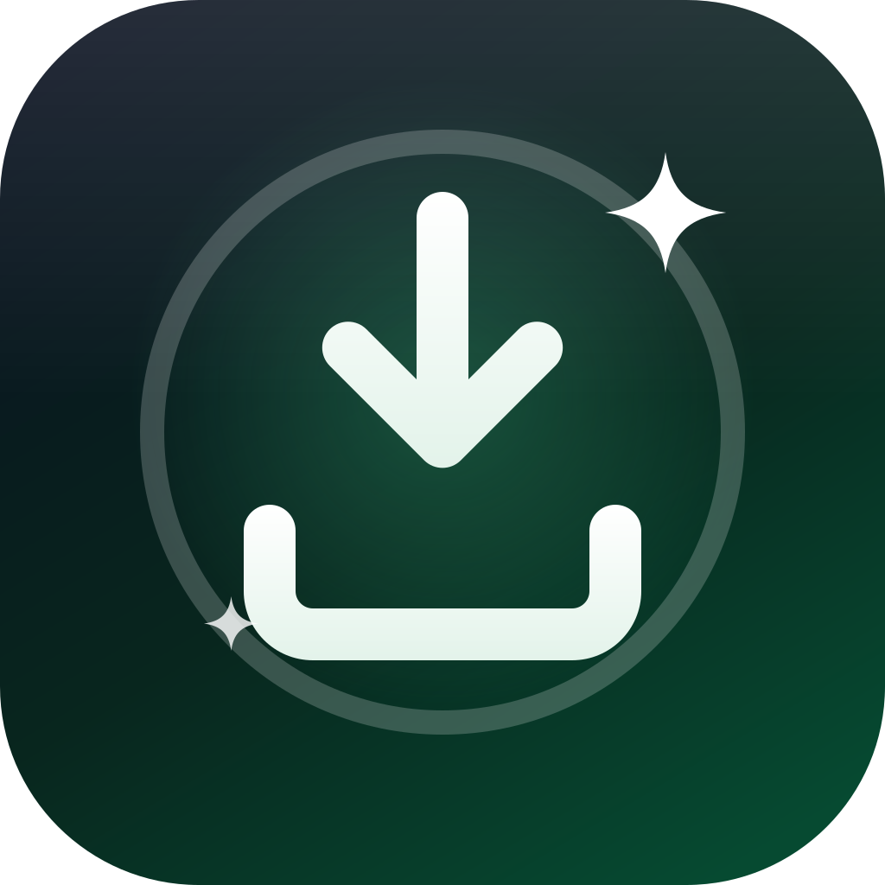

<div align="center">



# AltLoad

**直接用你自己的 Apple ID 在 iPhone 上安装 AltStore、SideStore 和 LiveContainer。无需电脑，不共享证书。**

[安装](https://altload.org/) · [下载 IPA](https://github.com/mirazbakis/AltLoad/releases/latest/download/AltLoad.ipa) · [添加源](https://altdirect.app/?url=https://raw.githubusercontent.com/mirazbakis/AltLoad/main/source.json) · [发布版本](https://github.com/mirazbakis/AltLoad/releases)

[English](README.md) · 简体中文 · [Русский](README.ru.md) · [Français](README.fr.md)

</div>

> [!CAUTION]
> **[altload.org](https://altload.org/) 和本仓库是仅有的官方来源。** AltLoad 免费，并会处理你的 Apple ID 密码和配对数据，所以来自其他地方的副本可能被修改以窃取它们。已经用过？请删除它，并在 [account.apple.com](https://account.apple.com) 修改你的 Apple ID 密码。

## 功能简介

侧载通常需要一台为应用签名并每 7 天刷新一次的电脑，或者一个 Apple 随时可能吊销的共享证书。AltLoad 在 iPhone 上完成电脑的工作：它让手机与自身配对，用你自己的 Apple ID 为商店签名并安装，然后在同一台设备上充当 AltServer，让 AltStore 能够刷新。它可以使用免费的 Apple ID，你的密码只会发送给 Apple。

| | 使用电脑 | 使用共享证书 | 使用 AltLoad |
| :-- | :-- | :-- | :-- |
| 需要电脑 | 是，安装和每次刷新都需要 | 通常只在设置时需要 | iOS 27 上不需要。iOS 18 至 26 需要一个配对文件 |
| 可能被无预警吊销 | 否 | 是，由 Apple 或证书所有者吊销 | 否。证书属于你 |
| 每周刷新 | 电脑需与其处于同一网络 | 与你的 Apple ID 无关 | 在 iPhone 上完成 |
| JIT | 需要电脑端工具 | 不属于证书的功能 | 内置 |
| 费用 | 免费 Apple ID 即可 | 由运行证书的人决定 | 免费 |

## 系统要求

| iOS | 安装与签名 | 配对 |
| :-- | :-- | :-- |
| **27 及更高版本** | 支持 | 在 iPhone 上完成，无需电脑 |
| **18 至 26** | 支持 | 导入一次性在电脑上用 [iloader](https://github.com/nab138/iloader) 或 [idevice_pair](https://github.com/jkcoxson/idevice_pair) 制作的远程配对文件 |
| **17 及更早版本** | 不支持 | 不支持 |

你还需要：

- 开启[开发者模式](https://developer.apple.com/documentation/xcode/enabling-developer-mode-on-a-device)
- App Store 中的 [LocalDevVPN](https://apps.apple.com/app/id6755608044)
- 一个 Apple ID。使用免费 Apple ID 时，应用有效期为 7 天

## 安装

**1. 获取 AltLoad。** 选择一种方式：

| 方式 | 适用场景 | 做法 |
| :-- | :-- | :-- |
| **Apple ID 安装**（推荐） | 使用你自己的 Apple ID 签名，无需电脑，也无需 DNS 描述文件 | 安装三款免费的 App Store 应用，并按照 [altload.org](https://altload.org/) 上的步骤操作。参见 [altpair/README.md](altpair/README.md) |
| **直接安装** | 最快的方式。使用共享证书，因此可能被吊销 | 在 Safari 中打开 [altload.org](https://altload.org/)，接受条款，添加 DNS 描述文件，然后点按已签名的安装 |
| **AltStore 或 SideStore** | 你已经在使用其中之一 | [添加源](https://altdirect.app/?url=https://raw.githubusercontent.com/mirazbakis/AltLoad/main/source.json)并在那里获取更新 |
| **你自己的签名工具** | 你自己为 IPA 签名 | 从[发布版本](https://github.com/mirazbakis/AltLoad/releases)下载 `AltLoad.ipa` |

**2. 配对你的 iPhone。** 在 AltLoad 中打开 **工具 › 配对**，然后前往 **设置 › 隐私与安全性 › 开发者模式 › 与 AltLoad 配对**，输入验证码。

**3. 安装商店。** 打开 LocalDevVPN，在 **安装** 标签页中选择一个商店并登录。

## 功能

**安装与签名**
- **商店：** AltStore Classic 与 Beta、SideStore 以及 SideStore + LiveContainer，可选稳定版或每夜版。还有 Husk、UTM、MeloNX 和 Madeira
- **你自己的应用：** 签名并安装任何来自“文件”的 IPA
- **开发者团队：** 如果你的 Apple ID 属于多个团队，可选择由哪个团队签名
- **多个 Apple ID：** 可保存多个，登录时切换。每个应用都会记住签名它的 Apple ID
- **权限：** 按应用设置功能，提供模拟器和网络工具的预设，并显示上一个描述文件实际授予的权限

**配对与刷新**
- **本机配对：** 在 iOS 27 上，输入灵动岛显示的验证码即可配对
- **本机 AltServer：** AltStore 像查找电脑一样查找 AltLoad，并可在后台持续运行
- **无需 AltServer 的 AltStore：** AltLoad 会将此 iPhone 的配对文件放在 AltStore 2.3.1 及更高版本查找的位置，因此 AltStore 可以自行刷新
- **自动刷新：** 在应用过期前刷新，并在后台为被吊销的应用重新签名，前提是已开启 LocalDevVPN 且已保存密码
- **配对文件：** 将此 iPhone 的配对文件放入 SideStore、StikDebug 及其他侧载应用中

**JIT 与工具**
- **JIT：** 可从“工具”、快捷指令、Siri 或主屏幕以 JIT 打开应用。可固定常用应用、运行脚本，并接收来自链接的请求
- **更多工具：** 位置模拟、证书、App ID 以及 App 扩展选项
- **日志：** 查看 AltLoad 执行的操作，失败时拷贝报告。邮箱会被遮蔽，密码从不记录

**语言：** 英语、中文、法语、德语、意大利语、日语、葡萄牙语（巴西）、俄语和西班牙语。

## 故障排除

出现问题时，打开 **设置 › 日志** 并点按 **拷贝**，或在错误页面点按 **拷贝日志**。然后将其粘贴到[问题反馈](https://github.com/mirazbakis/AltLoad/issues)中。

<details>
<summary><b>“无法连接到此 iPhone”或“连接被拒绝”</b></summary>
<br>

必须连接 LocalDevVPN，开启开发者模式，并且已在 **工具 › 配对** 中与此 iPhone 配对。如果 AltLoad 请求访问，请允许本地网络访问。关闭其他 VPN 或代理应用。如果仍然失败，请关闭再重新打开 LocalDevVPN，或重新配对。
</details>

<details>
<summary><b>登录失败</b></summary>
<br>

将 **设置 › Anisette** 保持为 **自动**。如果仍然无法登录，请点按 **重置 Anisette 数据**，几分钟后再试。如果 AltLoad 提示登录已暂停，请等待它显示的时间。
</details>

<details>
<summary><b>“可用 App ID 不足”</b></summary>
<br>

免费 Apple ID 每周只能创建 10 个 App ID，而每个 App 扩展通常都需要一个。安装前，请将 **App 扩展** 设置为 **保留，使用主描述文件** 或 **移除扩展**。
</details>

<details>
<summary><b>“已达到证书上限”</b></summary>
<br>

免费 Apple ID 只能获得少量开发证书。AltLoad 会询问你要吊销哪一个。用它在其他地方签名的应用会停止打开，直到重新签名。
</details>

<details>
<summary><b>商店无法下载</b></summary>
<br>

如果某个商店的所有源都无法访问，请通过其他途径获取它的 IPA，然后在“安装”标签页的 **…** 菜单中使用 **从文件安装 IPA**。
</details>

## 构建

你需要 Xcode、安装了 `aarch64-apple-ios` 和 `aarch64-apple-ios-sim` 目标的 Rust，以及 XcodeGen。

```sh
make test   # 核心与 altpair 的 Rust 测试
make ipa    # 生成 build/AltLoad.ipa，采用与发布版本相同的 ad-hoc 签名
make sim    # 构建模拟器版本
```

| 路径 | 内容 |
| :-- | :-- |
| `ios/` | SwiftUI 应用、实时活动扩展和翻译 |
| `core/` | 用于配对、设备隧道、登录、签名和安装的 Rust 核心 |
| `altpair/` | AltLoad 自带的工具，用于在无需电脑的情况下使用你的 Apple ID 安装它。参见其 [README](altpair/README.md) |
| `site/` | GitHub Pages 上的安装页面 |
| `signing/` | 已签名安装所用的脚本和证书包 |
| `docs/` | [工作原理](docs/HOW-IT-WORKS.md)和发布说明 |

## 许可证

AltLoad 是基于自定义 MIT 许可证的开源软件。你可以阅读、修改、为自己构建它，并在非商业项目中复用其部分内容，但须注明 *"Based on AltLoad by mirazbakis"*。构建版本只能通过本仓库和官方网站分发。参见 [LICENSE.md](LICENSE.md)。

按照 [SECURITY.md](SECURITY.md) 中的说明报告安全问题。使用 AltLoad 即表示你同意[服务条款](https://altload.org/terms.html)。AltLoad 与 Apple 以及它安装的任何应用均无关联。

有关 AltLoad 所依赖的项目，请参见 [ACKNOWLEDGMENTS.md](ACKNOWLEDGMENTS.md)；有关许可证，请参见 [THIRD_PARTY_NOTICES.md](THIRD_PARTY_NOTICES.md)。
