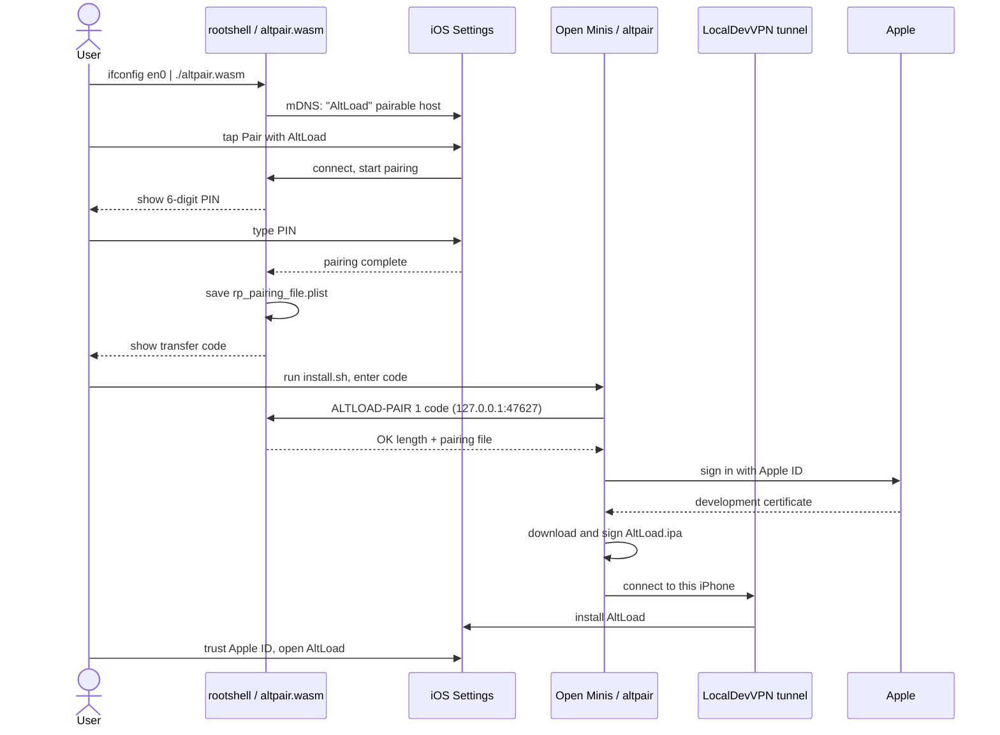

# altpair

altpair installs AltLoad on an iPhone with no computer, no shared certificate and no DNS profile. It is signed on the iPhone with your own Apple ID.

I wrote altpair from scratch as a pair of small tools for AltLoad:

- `pair/` builds `altpair.wasm`. It pairs the iPhone with itself.
- `installer/` builds `altpair`. It signs AltLoad and installs it.

## What you need

- An iPhone on iOS 27 or later, on Wi-Fi.
- Developer Mode turned on.
- An Apple ID. A free one works. The app is then valid for 7 days per signing.
- Three free apps from the App Store:
  - [rootshell](https://apps.apple.com/app/rootshell-local-terminal-ssh/id6755794662)
  - [Open Minis](https://apps.apple.com/app/id6759188481)
  - [LocalDevVPN](https://apps.apple.com/app/id6755608044)

## Use it

1. Open LocalDevVPN and connect.
2. Open rootshell. Download the pairing tool and start it:

   ```sh
   curl -fsSLO https://github.com/mirazbakis/AltLoad/releases/latest/download/altpair.wasm
   ifconfig en0 | ./altpair.wasm
   ```

3. The tool prints a Wi-Fi address and waits. Open Settings › Privacy & Security › Developer Mode. Tap **Pair with AltLoad** at the bottom.
4. Type the 6-digit PIN that rootshell shows. The tool then prints a 6-digit transfer code. Keep that tab open.
5. Open Open Minis. Run the installer:

   ```sh
   wget -qO- https://mirazbakis.github.io/AltLoad/install.sh | sh
   ```

6. Enter the transfer code, your Apple ID and your password when asked.
7. When it finishes, open Settings › General › VPN & Device Management, trust your Apple ID, and open AltLoad.

rootshell stops when it goes to the background. Turn on Location Diary Mode › Session Only in rootshell so it keeps running while you are in Settings.

## How it works

There are four stages.

### 1. Pair the iPhone with itself

`altpair.wasm` runs in rootshell. rootshell runs WASI programs and lends them sockets through its documented `rootshell_socket` interface. The tool uses that to:

- listen on a TCP port (49207 by default), and
- send an mDNS announcement for a `_remotepairing-pairable-host._tcp` host named "AltLoad".

On iOS 27 this makes **Pair with AltLoad** appear in Settings › Privacy & Security › Developer Mode. When you tap it, the iPhone connects to the tool and asks for a PIN. The tool shows the PIN in large digits. The pairing protocol is the pairing host from the [idevice](https://github.com/jkcoxson/idevice) crate. It is the same one AltLoad's app uses (`core/src/lib.rs`).

The result is `rp_pairing_file.plist`, saved in the folder where you ran the tool.

### 2. Hand the pairing file over

Open Minis cannot read rootshell's files. So the pairing tool offers the file on the loopback address `127.0.0.1:47627`, behind a random 6-digit transfer code.

- The client sends one line: `ALTLOAD-PAIR 1 <code>`, ending with a line feed.
- The tool answers `OK <length>`, a line feed, and then the plist bytes. Or it answers `NO`.
- After 5 wrong requests the tool stops serving.

### 3. Sign and install

`altpair` runs in Open Minis, a Linux shell on the iPhone. LocalDevVPN must be connected. It gives the iPhone a route back to itself, so the installer can reach the phone's own device services.

`altpair` then:

1. fetches the pairing file with the transfer code,
2. signs in to Apple with your Apple ID,
3. downloads AltLoad's latest release IPA from GitHub,
4. signs it and installs it over the tunnel.

All of that is AltLoad's own Rust core (`core/`). It is the same pipeline the app uses to install AltStore, driven from a terminal.

### 4. Trust and open

Trust your Apple ID in Settings › General › VPN & Device Management. Then open AltLoad.

### Sequence



### The pieces

| Tool | Runs in | Built from |
| --- | --- | --- |
| `altpair.wasm` | rootshell | `pair/`, Rust for `wasm32-wasip1`, with the idevice pairing host |
| `altpair` | Open Minis (Alpine Linux, ARM64) | `installer/`, Rust, static `aarch64-unknown-linux-musl`, on AltLoad's `core/` |
| `install.sh` | Open Minis | Shell script that downloads and checks `altpair` |
| LocalDevVPN | iOS, a VPN profile | Not ours. It routes the iPhone back to itself |

## Why three apps

**rootshell.** iOS apps cannot normally announce a service over mDNS or listen for the iPhone's own pairing request. rootshell lends WASI programs raw sockets, so `altpair.wasm` can send the announcement and accept the connection. A normal iOS app would need to stay in the foreground and hold special entitlements.

**Open Minis.** The installer is a native Linux program. It needs a real Linux shell with files, DNS and TLS. Open Minis gives you an Alpine ARM64 shell where a static binary just runs.

**LocalDevVPN.** An iPhone cannot connect to its own device services directly. iOS delivers that traffic over loopback, and the services refuse it. LocalDevVPN reflects packets for a private address back to the phone, so the connection looks like it came from another machine. Only that one address goes through it. Your other traffic does not.

## Security

What leaves the phone:

- Your Apple ID sign-in, sent to Apple. The password goes to Apple only.
- A request to an anisette server. Sign-in needs anisette data. The installer checks a built-in list of community servers (`/v3/client_info`, 5 s) and uses the ones that answer. You can pick one first with `--anisette`.
- The IPA download from GitHub (`github.com/mirazbakis/AltLoad/releases`), unless you pass `--ipa`.

What does not:

- Your password is not written to disk by the installer.
- The pairing file stays on the device. It only moves over `127.0.0.1`.
- The transfer code protects that hand-off. It is random, six digits, and compared in constant time. The tool gives up after 5 wrong tries. The listener accepts connections from this iPhone only, because it is bound to the loopback address.
- `install.sh` checks the SHA-256 of the `altpair` binary against the `.sha256` file from the same release before it runs it.

The pairing tool also listens on the Wi-Fi port while it waits to be paired. It stops listening once the iPhone has connected. Anyone on the network could try to pair in that window, but they would need the PIN shown on your screen.

## Flags and files

### `altpair` (installer)

| Flag | Meaning |
| --- | --- |
| `--ipa <url\|path>` | Install this IPA instead of AltLoad's latest release |
| `--repair` | Fetch a new pairing file even when one is saved |
| `--anisette <url>` | Anisette server to try first. Must be `https://` |
| `-h`, `--help` | Show help |
| `-V`, `--version` | Show the version |

| Variable | Meaning |
| --- | --- |
| `ALTPAIR_APPLE_ID` | Apple ID email. Skips that question |
| `ALTPAIR_PASSWORD` | Apple ID password. Skips that question |

The state directory is `~/.altload` inside Open Minis. It keeps the saved pairing file and the signing state from AltLoad's core (certificate key and anisette state), so a second run does not ask for the transfer code again.

### `altpair.wasm` (pairing tool)

| Flag | Meaning |
| --- | --- |
| `--ip A.B.C.D` | Wi-Fi address to use. Without it the tool asks the host, then reads `ifconfig` from stdin |
| `--port N` | Pairing port. Default 49207 |
| `--repair` | Pair again even if `rp_pairing_file.plist` exists |
| `-h`, `--help` | Show help |

Exit codes: 0 ok, 1 failure, 2 usage.

The tool writes `rp_pairing_file.plist` in its working directory. If that file already exists it reuses it and serves it again.

## Build it yourself

The pairing tool:

```sh
cd altpair/pair
rustup target add wasm32-wasip1
cargo build --release --target wasm32-wasip1
# output: target/wasm32-wasip1/release/altpair.wasm
```

The installer:

```sh
cd altpair/installer
rustup target add aarch64-unknown-linux-musl
cargo build --release --target aarch64-unknown-linux-musl
# output: target/aarch64-unknown-linux-musl/release/altpair
```

Each folder is its own Cargo workspace. The installer depends on `../../core`. Both pin the same idevice revision as the core.

The only builds I publish are on AltLoad's releases. They are built by `.github/workflows/altpair.yml`, which attaches `altpair.wasm`, `altpair-aarch64` and their `.sha256` files to each AltLoad release.

## Status

I haven't run this on an iPhone yet. I have not verified:

- That iOS 27 shows **Pair with AltLoad** for an announcement sent from rootshell.
- That the pairing completes through rootshell's socket interface.
- That the installer can reach the iPhone through LocalDevVPN from Open Minis.
- A full Apple ID sign-in, signing and install from Open Minis.
- That `install.sh` and the release workflow work end to end.

## Credits

- [idevice](https://github.com/jkcoxson/idevice) by Jackson Coxson, for the pairing host and the device protocols.
- [isideload](https://github.com/nab138/isideload), used by AltLoad's core for Apple ID sign-in and signing.
- rootshell's [WASM interface](https://github.com/kitknox/rootshell/tree/main/wasm), MIT, Kit Knox / Rootshell LLC.
- Open Minis, for the Linux shell.
- [LocalDevVPN](https://github.com/jkcoxson/LocalDevVPN), for the route back to the iPhone.

altpair contains no code from rootshell or Open Minis. I wrote it myself.
